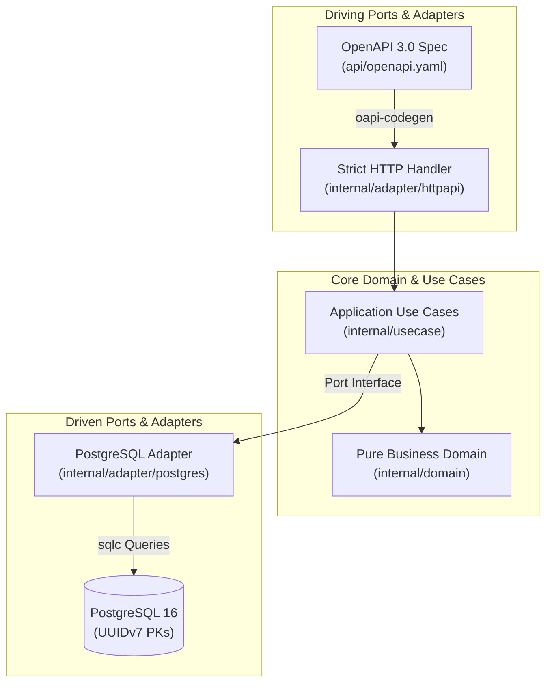

# Hotel Booking

Hotel Booking is a Go service for registering and finding hotels, searching for available rooms, and creating and retrieving bookings. It uses an OpenAPI-first HTTP API, PostgreSQL persistence, and hexagonal architecture.

---

## Architecture



- **Hotel management**: Register hotels and search for hotels by name.
- **Room availability**: Find available rooms for a date range and number of guests.
- **Bookings**: Book a room and retrieve a booking using its reference.
- **Spec-first API**: The OpenAPI specification defines the HTTP contract and generates server types.
- **PostgreSQL persistence**: SQL queries are generated with `sqlc` and schema migrations are managed with `goose`.

---


## Quickstart

### Prerequisites

- [Mise](https://mise.jdx.dev/) (manages Go runtime and dev tools)
- [Docker](https://docs.docker.com/get-docker/) & Docker Compose

### Running Locally

```bash
# 1. Install toolchain via mise
mise install

# 2. Copy the environment configuration template
cp .env.example .env

# 3. Start PostgreSQL and run migrations
mise run docker:compose-up
mise run migrate:up

# 4. Run the server
go run ./cmd/server
```

The server starts on `http://localhost:8080`:

- **Health check probe**: `GET http://localhost:8080/healthz`
- **Swagger UI**: `GET http://localhost:8080/docs/`
- **OpenAPI Specification**: `GET http://localhost:8080/openapi.json`
- **Hotels**: `GET /api/v1/hotels?name=grand`, `POST /api/v1/hotels`
- **Room availability**: `GET /api/v1/rooms/available`
- **Bookings**: `POST /api/v1/bookings`, `GET /api/v1/bookings/{bookingReference}`

Swagger UI and the OpenAPI endpoint are available when API documentation is enabled; they are disabled in production.
